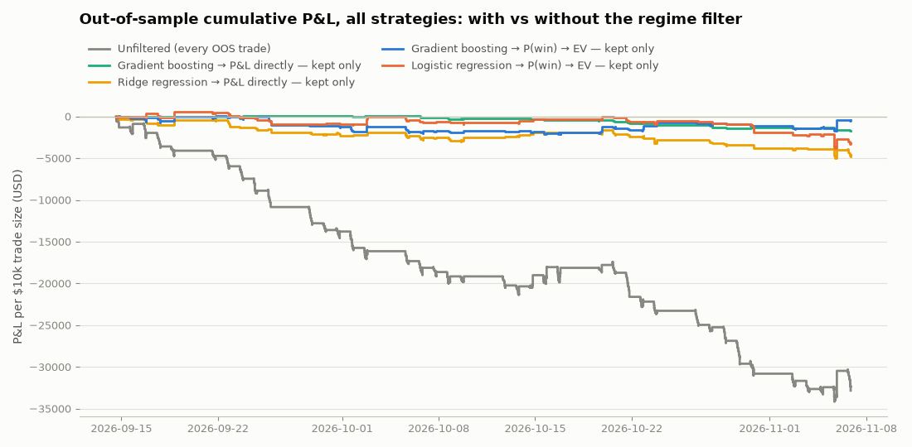

# Regime filters — learned from the journal, validated walk-forward

Generated 2026-11-07 · 60 sessions (2026-08-14 → 2026-11-06) ·
**walk-forward:** first 20 sessions train-only, then blocks of 5 sessions scored by a
model trained on every session before them · **40 out-of-sample sessions** · decision rule:
keep a trade when its predicted expected value is positive (classifiers: P(win)·avg_win +
(1−P(win))·avg_loss with averages from the training fold; regressors: predicted P&L) ·
"random same-size" = mean expectancy of 2,000 random subsets with the same trade count.

**No regime edge found.** Filtered OOS expectancy $-12.94/trade, 36th percentile vs random same-size selection — the conditions at entry do not predict which of these trades pay, out of sample.

## Models

| model | OOS trades | kept | exp./trade, all | exp./trade, kept | PF all → kept | random same-size | pctile vs random |
|---|---|---|---|---|---|---|---|
| Gradient boosting → P&L directly | 3098 | 133 (4%) | $-10.60 | $-12.94 | 0.64 → 0.44 | $-10.54 | 36 |
| Ridge regression → P&L directly | 3098 | 327 (11%) | $-10.60 | $-14.11 | 0.64 → 0.64 | $-10.64 | 17 |
| Gradient boosting → P(win) → EV | 3098 | 247 (8%) | $-10.60 | $-1.61 | 0.64 → 0.96 | $-10.74 | 98 |
| Logistic regression → P(win) → EV | 3098 | 149 (5%) | $-10.60 | $-21.21 | 0.64 → 0.69 | $-10.59 | 4 |



*Read the curves with care: a filtered line holds fewer trades, so its total shrinks
mechanically even under random selection. The fair comparison is expectancy per
trade against the "random same-size" column, not the gap between the curves.*

## Calibration — does a higher predicted EV actually pay? (Gradient boosting → P&L directly)

| predicted-EV quintile | trades | mean predicted EV | actual exp./trade | win rate |
|---|---|---|---|---|
| 1 (lowest) | 620 | $-43.44 | $-18.24 | 34% |
| 2 | 619 | $-29.29 | $-13.54 | 33% |
| 3 | 620 | $-22.30 | $-5.42 | 34% |
| 4 | 619 | $-11.08 | $-5.76 | 42% |
| 5 (highest) | 620 | $-1.99 | $-10.01 | 38% |

A filter is only as good as this table is monotonic. If the top quintile does not
out-earn the bottom one out of sample, the model has learned to rank trades by
something other than what pays.

## Per strategy — Gradient boosting → P&L directly filter, out-of-sample only

| strategy | OOS trades | kept | exp./trade, all | exp./trade, kept | PF all → kept | P&L all → kept | random same-size | pctile vs random |
|---|---|---|---|---|---|---|---|---|
| Gap & Go | 2 | 0 (0%) ⚠ | $+45.91 | — | 2.58 → — | $+91.82 → $+0.00 | — | — |
| Opening Range Breakout | 337 | 9 (3%) ⚠ | $-12.40 | $-54.14 | 0.78 → 0.15 | $-4,179.66 → $-487.27 | $-12.84 | 17 |
| VWAP Pullback | 466 | 0 (0%) ⚠ | $-6.74 | — | 0.81 → — | $-3,141.19 → $+0.00 | — | — |
| EMA 9/20 Crossover | 425 | 0 (0%) ⚠ | $-11.83 | — | 0.54 → — | $-5,027.52 → $+0.00 | — | — |
| RSI(2) Reversion | 746 | 105 (14%) | $-7.36 | $-8.72 | 0.40 → 0.50 | $-5,493.66 → $-915.30 | $-7.39 | 29 |
| News Momentum | 62 | 0 (0%) ⚠ | $-19.64 | — | 0.49 → — | $-1,217.41 → $+0.00 | — | — |
| Squeeze Breakout | 283 | 0 (0%) ⚠ | $-11.15 | — | 0.58 → — | $-3,155.11 → $+0.00 | — | — |
| High-Break ATR Trail | 301 | 0 (0%) ⚠ | $-17.98 | — | 0.57 → — | $-5,410.67 → $+0.00 | — | — |
| AR Forecast | 476 | 19 (4%) | $-11.12 | $-16.76 | 0.54 → 0.52 | $-5,292.20 → $-318.36 | $-11.28 | 30 |
| **All strategies** | 3098 | 133 (4%) | $-10.60 | $-12.94 | 0.64 → 0.44 | $-32,825.60 → $-1,720.93 | $-10.54 | 36 |

⚠ = fewer than 10 kept trades; noise, not evidence. "pctile vs random" is where
the filtered expectancy lands among 2,000 random subsets of the same size (≥95 = the selection
is doing something chance rarely does).

## Long vs short — side policies, out-of-sample only (Gradient boosting → P&L directly)

| book | trades | exp./trade | profit factor | P&L | pctile vs random same-size |
|---|---|---|---|---|---|
| Unfiltered, both sides | 3098 | $-10.60 | 0.64 | $-32,825.60 | — |
| Long only (unfiltered) | 1559 | $-16.01 | 0.49 | $-24,951.97 | 0 |
| Short only (unfiltered) | 1539 | $-5.12 | 0.81 | $-7,873.63 | 100 |
| Filter on every trade (`_regime` variants) | 133 | $-12.94 | 0.44 | $-1,720.93 | 37 |
| Live policy: shorts unfiltered, longs only when EV > 0, orb exempt | 1747 | $-7.64 | 0.75 | $-13,348.84 | 100 |

The live paper scanner runs the last row (`long_gate="regime"`). "Long only" /
"Short only" answer whether one side alone carries the losses; the live policy
is only worth keeping if it beats the unfiltered book *and* sits well above
random same-size selection. Unlike the paper journal, these are backtest fills.

## Fold by fold — Gradient boosting → P&L directly

| fold | test sessions | train sessions | trades | kept | exp./trade, all | exp./trade, kept |
|---|---|---|---|---|---|---|
| 1 | 2026-09-14 → 2026-09-18 | 20 | 379 | 11 | $-10.81 | $-1.28 |
| 2 | 2026-09-21 → 2026-09-25 | 25 | 387 | 7 | $-17.45 | $+11.56 |
| 3 | 2026-09-28 → 2026-10-02 | 30 | 394 | 9 | $-13.42 | $+1.56 |
| 4 | 2026-10-05 → 2026-10-09 | 35 | 391 | 17 | $-7.71 | $-20.81 |
| 5 | 2026-10-12 → 2026-10-16 | 40 | 388 | 18 | $+2.64 | $-6.07 |
| 6 | 2026-10-19 → 2026-10-23 | 45 | 376 | 28 | $-13.69 | $-21.87 |
| 7 | 2026-10-26 → 2026-10-30 | 50 | 386 | 15 | $-19.51 | $-21.66 |
| 8 | 2026-11-02 → 2026-11-06 | 55 | 397 | 28 | $-5.09 | $-14.33 |

## What the filter looks at

Permutation importance measured on the decision that matters: how much OOS
filtered expectancy falls when one feature is shuffled in the test fold.

| feature | OOS expectancy drop when shuffled |
|---|---|
| mkt_atr_pct | $+4.47 |
| aligned_range_pos | $+2.68 |
| aligned_spy_pct | $+2.12 |
| mkt_range_pos | $+0.48 |
| weekday_num | $+0.31 |
| mkt_change_open_pct | $+0.27 |
| mkt_gap_pct | $+0.04 |
| is_short | $+0.00 |

Features prefixed `aligned_` are signed by trade direction (a short's SPY move is
negated), so one pooled model can treat "long in a rising tape" and "short in a
falling tape" as the same regime.


## Descriptive rules (in-sample, for reading — not evidence)

Depth-2 decision trees per strategy on the full window, so the filter's opinion is
legible. `weights: [losers, winners]` per leaf. These were fit on all sessions and
prove nothing; the walk-forward tables above are the evidence.

**Opening Range Breakout**

```
|--- mkt_range_pos <= 0.92
|   |--- aligned_trend_slope_pct <= 0.32
|   |   |--- weights: [186.00, 133.00] class: 0
|   |--- aligned_trend_slope_pct >  0.32
|   |   |--- weights: [16.00, 36.00] class: 1
|--- mkt_range_pos >  0.92
|   |--- aligned_spy_pct <= -0.21
|   |   |--- weights: [9.00, 8.00] class: 0
|   |--- aligned_spy_pct >  -0.21
|   |   |--- weights: [91.00, 21.00] class: 0
```

**VWAP Pullback**

```
|--- mkt_atr_pct <= 0.20
|   |--- mkt_gap_pct <= 0.63
|   |   |--- weights: [44.00, 5.00] class: 0
|   |--- mkt_gap_pct >  0.63
|   |   |--- weights: [13.00, 7.00] class: 0
|--- mkt_atr_pct >  0.20
|   |--- aligned_range_pos <= -0.04
|   |   |--- weights: [163.00, 135.00] class: 0
|   |--- aligned_range_pos >  -0.04
|   |   |--- weights: [236.00, 106.00] class: 0
```

**EMA 9/20 Crossover**

```
|--- mkt_spy_change_pct <= -0.63
|   |--- weights: [15.00, 14.00] class: 0
|--- mkt_spy_change_pct >  -0.63
|   |--- mkt_range_pos <= 0.13
|   |   |--- weights: [24.00, 16.00] class: 0
|   |--- mkt_range_pos >  0.13
|   |   |--- weights: [459.00, 124.00] class: 0
```

**RSI(2) Reversion**

```
|--- mkt_atr_pct <= 0.31
|   |--- mkt_realized_vol_pct <= 2.36
|   |   |--- weights: [512.00, 191.00] class: 0
|   |--- mkt_realized_vol_pct >  2.36
|   |   |--- weights: [9.00, 16.00] class: 1
|--- mkt_atr_pct >  0.31
|   |--- mkt_spy_change_pct <= -0.38
|   |   |--- weights: [16.00, 46.00] class: 1
|   |--- mkt_spy_change_pct >  -0.38
|   |   |--- weights: [179.00, 170.00] class: 0
```

**News Momentum**

```
|--- aligned_change_open_pct <= 0.87
|   |--- aligned_trend_slope_pct <= 0.00
|   |   |--- weights: [5.00, 10.00] class: 1
|   |--- aligned_trend_slope_pct >  0.00
|   |   |--- weights: [11.00, 5.00] class: 0
|--- aligned_change_open_pct >  0.87
|   |--- mkt_gap_pct <= 0.56
|   |   |--- weights: [32.00, 3.00] class: 0
|   |--- mkt_gap_pct >  0.56
|   |   |--- weights: [12.00, 6.00] class: 0
```

**Squeeze Breakout**

```
|--- aligned_dist_vwap_pct <= 1.89
|   |--- aligned_range_pos <= -0.05
|   |   |--- weights: [100.00, 53.00] class: 0
|   |--- aligned_range_pos >  -0.05
|   |   |--- weights: [208.00, 56.00] class: 0
|--- aligned_dist_vwap_pct >  1.89
|   |--- weights: [9.00, 14.00] class: 1
```

**High-Break ATR Trail**

```
|--- mkt_change_open_pct <= -1.31
|   |--- aligned_change_open_pct <= 3.01
|   |   |--- weights: [34.00, 48.00] class: 1
|   |--- aligned_change_open_pct >  3.01
|   |   |--- weights: [14.00, 3.00] class: 0
|--- mkt_change_open_pct >  -1.31
|   |--- mkt_rel_volume <= 0.98
|   |   |--- weights: [175.00, 56.00] class: 0
|   |--- mkt_rel_volume >  0.98
|   |   |--- weights: [65.00, 42.00] class: 0
```

**AR Forecast**

```
|--- mkt_range_pos <= 0.04
|   |--- weights: [25.00, 2.00] class: 0
|--- mkt_range_pos >  0.04
|   |--- aligned_spy_pct <= 0.21
|   |   |--- weights: [316.00, 186.00] class: 0
|   |--- aligned_spy_pct >  0.21
|   |   |--- weights: [68.00, 79.00] class: 1
```


## The live filter

`regime_model.joblib` — Gradient boosting → P&L directly, fitted on all 60 sessions
(4641 trades). The paper scanner scores every base-strategy signal with it and
places a second order tagged `<strategy>_regime` only when predicted EV > 0, so
`paper_journal.csv` accumulates a live filtered-vs-unfiltered comparison; every journal row also
carries `regime_ev`, the filter's verdict at entry. Re-fitted each Saturday as the window rolls.

## How to read this honestly

- Every OOS number comes from a model that never saw the session it scored.
- A filter can only *remove* trades. If the entries have no edge in any regime,
  the best it can do is lose less — the "PF all → kept" column shows whether it
  found a subset that actually pays.
- With ~40 OOS sessions in one market regime, "gate met" here means *earned a
  paper-trading test*, not "trade it".
