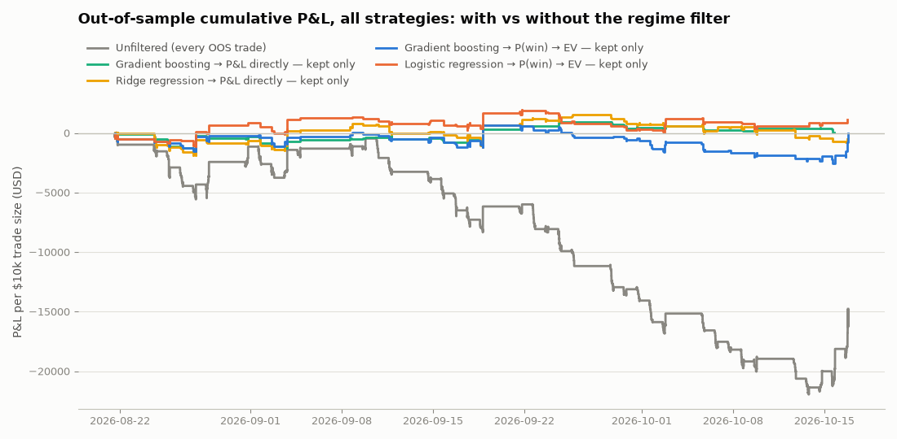

# Regime filters — learned from the journal, validated walk-forward

Generated 2026-10-17 · 60 sessions (2026-07-24 → 2026-10-16) ·
**walk-forward:** first 20 sessions train-only, then blocks of 5 sessions scored by a
model trained on every session before them · **40 out-of-sample sessions** · decision rule:
keep a trade when its predicted expected value is positive (classifiers: P(win)·avg_win +
(1−P(win))·avg_loss with averages from the training fold; regressors: predicted P&L) ·
"random same-size" = mean expectancy of 2,000 random subsets with the same trade count.

**Positive but not yet distinguishable from luck.** Filtered OOS expectancy is $+0.19/trade, but only the 87th percentile of same-size random selections — a random subset of the same size lands here often enough that this cannot be called an edge.

## Models

| model | OOS trades | kept | exp./trade, all | exp./trade, kept | PF all → kept | random same-size | pctile vs random |
|---|---|---|---|---|---|---|---|
| Gradient boosting → P&L directly | 2004 | 204 (10%) | $-7.37 | $+0.19 | 0.80 → 1.01 | $-7.64 | 87 |
| Ridge regression → P&L directly | 2004 | 404 (20%) | $-7.37 | $-1.20 | 0.80 → 0.97 | $-7.25 | 90 |
| Gradient boosting → P(win) → EV | 2004 | 298 (15%) | $-7.37 | $-0.10 | 0.80 → 1.00 | $-7.52 | 91 |
| Logistic regression → P(win) → EV | 2004 | 201 (10%) | $-7.37 | $+5.62 | 0.80 → 1.11 | $-7.20 | 96 |



*Read the curves with care: a filtered line holds fewer trades, so its total shrinks
mechanically even under random selection. The fair comparison is expectancy per
trade against the "random same-size" column, not the gap between the curves.*

## Calibration — does a higher predicted EV actually pay? (Gradient boosting → P&L directly)

| predicted-EV quintile | trades | mean predicted EV | actual exp./trade | win rate |
|---|---|---|---|---|
| 1 (lowest) | 401 | $-63.83 | $-13.87 | 35% |
| 2 | 401 | $-36.67 | $-0.56 | 34% |
| 3 | 400 | $-23.44 | $-3.40 | 38% |
| 4 | 401 | $-9.02 | $-10.42 | 42% |
| 5 (highest) | 401 | $+4.05 | $-8.59 | 42% |

A filter is only as good as this table is monotonic. If the top quintile does not
out-earn the bottom one out of sample, the model has learned to rank trades by
something other than what pays.

## Per strategy — Gradient boosting → P&L directly filter, out-of-sample only

| strategy | OOS trades | kept | exp./trade, all | exp./trade, kept | PF all → kept | P&L all → kept | random same-size | pctile vs random |
|---|---|---|---|---|---|---|---|---|
| Gap & Go | 8 | 1 (12%) ⚠ | $+230.78 | $+424.91 | 64.18 → ∞ | $+1,846.23 → $+424.91 | $+224.55 | 89 |
| Opening Range Breakout | 196 | 27 (14%) | $+8.91 | $+60.11 | 1.12 → 1.88 | $+1,745.85 → $+1,622.86 | $+9.22 | 91 |
| VWAP Pullback | 290 | 9 (3%) ⚠ | $-11.60 | $-14.20 | 0.77 → 0.58 | $-3,363.46 → $-127.80 | $-12.32 | 51 |
| EMA 9/20 Crossover | 248 | 2 (1%) ⚠ | $-14.97 | $-68.38 | 0.58 → 0.00 | $-3,712.31 → $-136.77 | $-13.59 | 7 |
| RSI(2) Reversion | 449 | 93 (21%) | $-9.31 | $-8.84 | 0.46 → 0.49 | $-4,180.32 → $-822.14 | $-9.33 | 57 |
| News Momentum | 43 | 0 (0%) ⚠ | $-23.75 | — | 0.50 → — | $-1,021.31 → $+0.00 | — | — |
| Squeeze Breakout | 177 | 0 (0%) ⚠ | $-10.40 | — | 0.70 → — | $-1,840.91 → $+0.00 | — | — |
| High-Break ATR Trail | 177 | 5 (3%) ⚠ | $-0.14 | $+33.84 | 1.00 → 1.34 | $-24.67 → $+169.21 | $-1.79 | 76 |
| AR Forecast | 416 | 67 (16%) | $-10.15 | $-16.30 | 0.61 → 0.58 | $-4,223.83 → $-1,091.80 | $-9.98 | 16 |
| **All strategies** | 2004 | 204 (10%) | $-7.37 | $+0.19 | 0.80 → 1.01 | $-14,774.73 → $+38.47 | $-7.64 | 87 |

⚠ = fewer than 10 kept trades; noise, not evidence. "pctile vs random" is where
the filtered expectancy lands among 2,000 random subsets of the same size (≥95 = the selection
is doing something chance rarely does).

## Long vs short — side policies, out-of-sample only (Gradient boosting → P&L directly)

| book | trades | exp./trade | profit factor | P&L | pctile vs random same-size |
|---|---|---|---|---|---|
| Unfiltered, both sides | 2004 | $-7.37 | 0.80 | $-14,774.73 | — |
| Long only (unfiltered) | 1036 | $-12.69 | 0.69 | $-13,149.93 | 1 |
| Short only (unfiltered) | 968 | $-1.68 | 0.95 | $-1,624.80 | 99 |
| Filter on every trade (`_regime` variants) | 204 | $+0.19 | 1.01 | $+38.47 | 86 |
| Live policy: shorts unfiltered, longs only when EV > 0, orb exempt | 1186 | $-2.87 | 0.92 | $-3,406.62 | 99 |

The live paper scanner runs the last row (`long_gate="regime"`). "Long only" /
"Short only" answer whether one side alone carries the losses; the live policy
is only worth keeping if it beats the unfiltered book *and* sits well above
random same-size selection. Unlike the paper journal, these are backtest fills.

## Fold by fold — Gradient boosting → P&L directly

| fold | test sessions | train sessions | trades | kept | exp./trade, all | exp./trade, kept |
|---|---|---|---|---|---|---|
| 1 | 2026-08-21 → 2026-08-27 | 20 | 254 | 50 | $-17.02 | $-3.98 |
| 2 | 2026-08-28 → 2026-09-03 | 25 | 248 | 36 | $+11.72 | $-13.56 |
| 3 | 2026-09-04 → 2026-09-11 | 30 | 240 | 25 | $-7.67 | $+7.39 |
| 4 | 2026-09-14 → 2026-09-18 | 35 | 256 | 24 | $-11.37 | $+34.68 |
| 5 | 2026-09-21 → 2026-09-25 | 40 | 254 | 12 | $-19.70 | $+48.49 |
| 6 | 2026-09-28 → 2026-10-02 | 45 | 259 | 32 | $-15.40 | $-9.54 |
| 7 | 2026-10-05 → 2026-10-09 | 50 | 255 | 15 | $-14.89 | $-12.69 |
| 8 | 2026-10-12 → 2026-10-16 | 55 | 238 | 10 | $+17.57 | $-37.77 |

## What the filter looks at

Permutation importance measured on the decision that matters: how much OOS
filtered expectancy falls when one feature is shuffled in the test fold.

| feature | OOS expectancy drop when shuffled |
|---|---|
| mkt_trend_slope_pct | $+11.19 |
| aligned_trend_slope_pct | $+11.09 |
| mkt_change_open_pct | $+9.73 |
| mkt_gap_pct | $+7.75 |
| mkt_dist_vwap_pct | $+6.01 |
| mkt_rel_volume | $+4.70 |
| mkt_autocorr_1 | $+2.80 |
| aligned_change_open_pct | $+2.24 |

Features prefixed `aligned_` are signed by trade direction (a short's SPY move is
negated), so one pooled model can treat "long in a rising tape" and "short in a
falling tape" as the same regime.

## Paper-journal check (real fills, different execution path)

A filter fitted only on backtest sessions before the paper loop's first fill
(2026-08-24) was applied to the **790 real paper trades** from
2026-08-24 to 2026-10-16. It kept 86; expectancy
$-0.95 → $+9.39/trade
(76th percentile vs same-size random selection). Small
sample — a direction check, not a verdict.

## Descriptive rules (in-sample, for reading — not evidence)

Depth-2 decision trees per strategy on the full window, so the filter's opinion is
legible. `weights: [losers, winners]` per leaf. These were fit on all sessions and
prove nothing; the walk-forward tables above are the evidence.

**Opening Range Breakout**

```
|--- aligned_change_open_pct <= 1.90
|   |--- aligned_range_pos <= -0.17
|   |   |--- weights: [12.00, 16.00] class: 1
|   |--- aligned_range_pos >  -0.17
|   |   |--- weights: [127.00, 61.00] class: 0
|--- aligned_change_open_pct >  1.90
|   |--- mkt_autocorr_1 <= -0.33
|   |   |--- weights: [28.00, 18.00] class: 0
|   |--- mkt_autocorr_1 >  -0.33
|   |   |--- weights: [12.00, 34.00] class: 1
```

**VWAP Pullback**

```
|--- mkt_autocorr_1 <= 0.12
|   |--- hour_et <= 14.79
|   |   |--- weights: [225.00, 81.00] class: 0
|   |--- hour_et >  14.79
|   |   |--- weights: [5.00, 10.00] class: 1
|--- mkt_autocorr_1 >  0.12
|   |--- aligned_change_open_pct <= 0.37
|   |   |--- weights: [23.00, 4.00] class: 0
|   |--- aligned_change_open_pct >  0.37
|   |   |--- weights: [41.00, 52.00] class: 1
```

**EMA 9/20 Crossover**

```
|--- mkt_realized_vol_pct <= 4.38
|   |--- aligned_range_pos <= -0.54
|   |   |--- weights: [9.00, 8.00] class: 0
|   |--- aligned_range_pos >  -0.54
|   |   |--- weights: [243.00, 78.00] class: 0
|--- mkt_realized_vol_pct >  4.38
|   |--- mkt_trend_slope_pct <= -0.00
|   |   |--- weights: [6.00, 13.00] class: 1
|   |--- mkt_trend_slope_pct >  -0.00
|   |   |--- weights: [16.00, 5.00] class: 0
```

**RSI(2) Reversion**

```
|--- mkt_realized_vol_pct <= 1.75
|   |--- aligned_spy_pct <= -0.21
|   |   |--- weights: [5.00, 11.00] class: 1
|   |--- aligned_spy_pct >  -0.21
|   |   |--- weights: [81.00, 22.00] class: 0
|--- mkt_realized_vol_pct >  1.75
|   |--- aligned_spy_pct <= 0.43
|   |   |--- weights: [251.00, 227.00] class: 0
|   |--- aligned_spy_pct >  0.43
|   |   |--- weights: [34.00, 71.00] class: 1
```

**News Momentum**

```
|--- mkt_spy_change_pct <= -0.21
|   |--- weights: [12.00, 13.00] class: 1
|--- mkt_spy_change_pct >  -0.21
|   |--- mkt_trend_slope_pct <= -0.02
|   |   |--- weights: [11.00, 4.00] class: 0
|   |--- mkt_trend_slope_pct >  -0.02
|   |   |--- weights: [24.00, 1.00] class: 0
```

**Squeeze Breakout**

```
|--- mkt_autocorr_1 <= -0.21
|   |--- mkt_spy_change_pct <= -0.02
|   |   |--- weights: [17.00, 8.00] class: 0
|   |--- mkt_spy_change_pct >  -0.02
|   |   |--- weights: [25.00, 0.00] class: 0
|--- mkt_autocorr_1 >  -0.21
|   |--- mkt_autocorr_1 <= -0.16
|   |   |--- weights: [12.00, 13.00] class: 1
|   |--- mkt_autocorr_1 >  -0.16
|   |   |--- weights: [135.00, 57.00] class: 0
```

**High-Break ATR Trail**

```
|--- aligned_change_open_pct <= 1.47
|   |--- mkt_autocorr_1 <= -0.14
|   |   |--- weights: [43.00, 3.00] class: 0
|   |--- mkt_autocorr_1 >  -0.14
|   |   |--- weights: [38.00, 22.00] class: 0
|--- aligned_change_open_pct >  1.47
|   |--- hour_et <= 12.46
|   |   |--- weights: [68.00, 66.00] class: 0
|   |--- hour_et >  12.46
|   |   |--- weights: [17.00, 4.00] class: 0
```

**AR Forecast**

```
|--- mkt_rel_volume <= 0.25
|   |--- weights: [19.00, 3.00] class: 0
|--- mkt_rel_volume >  0.25
|   |--- weekday_num <= 0.50
|   |   |--- weights: [73.00, 35.00] class: 0
|   |--- weekday_num >  0.50
|   |   |--- weights: [253.00, 235.00] class: 0
```


## The live filter

`regime_model.joblib` — Gradient boosting → P&L directly, fitted on all 60 sessions
(3052 trades). The paper scanner scores every base-strategy signal with it and
places a second order tagged `<strategy>_regime` only when predicted EV > 0, so
`paper_journal.csv` accumulates a live filtered-vs-unfiltered comparison; every journal row also
carries `regime_ev`, the filter's verdict at entry. Re-fitted each Saturday as the window rolls.

## How to read this honestly

- Every OOS number comes from a model that never saw the session it scored.
- A filter can only *remove* trades. If the entries have no edge in any regime,
  the best it can do is lose less — the "PF all → kept" column shows whether it
  found a subset that actually pays.
- With ~40 OOS sessions in one market regime, "gate met" here means *earned a
  paper-trading test*, not "trade it".
