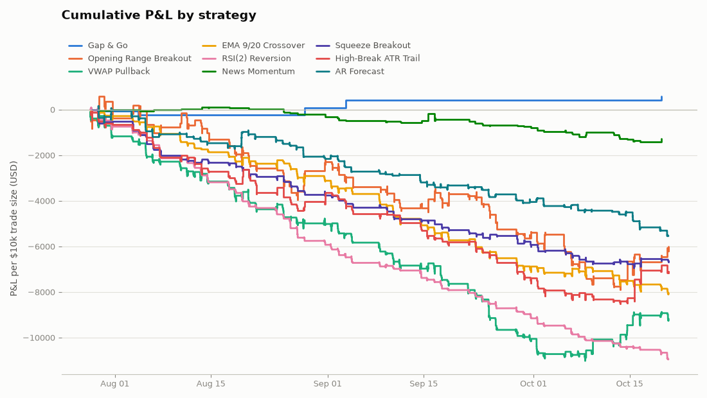

# Backtest results

Generated 2026-10-17 · window **2026-07-24 → 2026-10-16** ·
symbols **TSLA, NVDA, AMD, PLTR, COIN, MSTR** · bars **5m** ·
**$10,000** per trade · slippage **5 bps/side** ·
**1605 long / 1447 short**, everything flat by 15:55 ET.

## Ranking (by win rate)

| strategy | trades | win_rate_pct | avg_win | avg_loss | profit_factor | expectancy | total_pnl | max_drawdown | median_hold_min |
|---|---|---|---|---|---|---|---|---|---|
| Gap & Go | 12 | 75.0 | 272.13 | -343.39 | 2.38 | 118.25 | 1418.99 | -413.48 | 332.0 |
| RSI(2) Reversion | 702 | 47.2 | 18.64 | -36.43 | 0.46 | -10.46 | -7345.21 | -7573.8 | 15.0 |
| AR Forecast | 618 | 44.2 | 45.36 | -47.52 | 0.76 | -6.49 | -4008.89 | -4958.77 | 20.0 |
| Opening Range Breakout | 308 | 41.9 | 190.14 | -146.8 | 0.93 | -5.68 | -1749.73 | -4804.96 | 335.0 |
| High-Break ATR Trail | 261 | 36.4 | 124.52 | -93.39 | 0.76 | -14.08 | -3673.99 | -6370.64 | 165.0 |
| VWAP Pullback | 441 | 33.3 | 110.14 | -77.88 | 0.71 | -15.21 | -6707.18 | -9773.33 | 65.0 |
| Squeeze Breakout | 267 | 29.2 | 73.97 | -54.77 | 0.56 | -17.16 | -4581.46 | -5049.87 | 45.0 |
| News Momentum | 65 | 27.7 | 89.88 | -65.33 | 0.53 | -22.35 | -1452.72 | -1770.17 | 70.0 |
| EMA 9/20 Crossover | 378 | 27.5 | 80.81 | -46.55 | 0.66 | -11.51 | -4350.0 | -4887.63 | 55.0 |

Win rate alone doesn't pay — a high-win-rate strategy with avg losses larger than
avg wins can still lose money. Read it together with **profit_factor** (gross
wins / gross losses, >1 is profitable) and **expectancy** (avg $ per trade).

## How each strategy's trades ended (% of trades)

| strategy | eod | signal | stop | target |
|---|---|---|---|---|
| AR Forecast | 0.2 | 88.3 | 11.5 | 0.0 |
| EMA 9/20 Crossover | 23.0 | 56.3 | 20.6 | 0.0 |
| Gap & Go | 75.0 | 0.0 | 16.7 | 8.3 |
| High-Break ATR Trail | 36.0 | 0.0 | 64.0 | 0.0 |
| News Momentum | 33.8 | 0.0 | 53.8 | 12.3 |
| Opening Range Breakout | 67.9 | 0.0 | 26.3 | 5.8 |
| RSI(2) Reversion | 0.9 | 87.7 | 11.4 | 0.0 |
| Squeeze Breakout | 28.1 | 0.0 | 58.1 | 13.9 |
| VWAP Pullback | 22.7 | 0.0 | 58.3 | 19.0 |

`stop` = protective stop hit · `target` = fixed take-profit hit ·
`signal` = strategy's own exit rule · `eod` = flattened at the session cutoff.

## Long vs short, per strategy

| strategy | long trades | long exp./trade | short trades | short exp./trade |
|---|---|---|---|---|
| Gap & Go | 7 | $+159.14 | 5 | $+61.01 |
| Opening Range Breakout | 162 | $-5.45 | 146 | $-5.94 |
| VWAP Pullback | 236 | $-19.04 | 205 | $-10.80 |
| EMA 9/20 Crossover | 191 | $-20.25 | 187 | $-2.58 |
| RSI(2) Reversion | 352 | $-10.55 | 350 | $-10.37 |
| News Momentum | 28 | $-43.83 | 37 | $-6.09 |
| Squeeze Breakout | 150 | $-18.52 | 117 | $-15.42 |
| High-Break ATR Trail | 133 | $-1.44 | 128 | $-27.21 |
| AR Forecast | 346 | $-6.36 | 272 | $-6.65 |

Each side read as its own book. The walk-forward version of this question — with
the live long-gate policy scored against random selection — is in REGIME.md.

Full trade-by-trade log: [trades.csv](trades.csv).

*Small sample (yfinance caps 5-minute history at 60 days), one market regime,
liquid large caps rather than true low-float gappers — see the README's
limitations section before reading anything into these numbers.*
