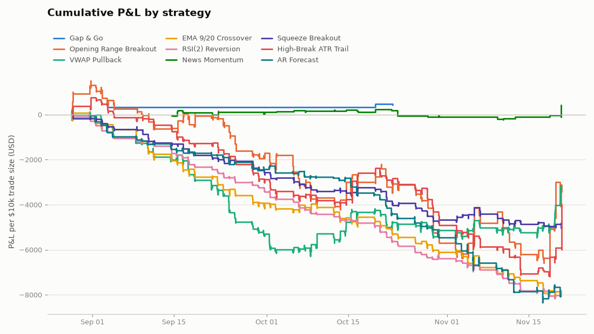

# Backtest results

Generated 2026-11-21 · window **2026-08-28 → 2026-11-20** ·
symbols **NVDA, TSLA, COIN, AMZN, JPM, XOM, UNH, WMT, CAT, LLY** · bars **5m** ·
**$10,000** per trade · slippage **5 bps/side** ·
**2267 long / 2316 short**, everything flat by 15:55 ET.

## Ranking (by win rate)

| strategy | trades | win_rate_pct | avg_win | avg_loss | profit_factor | expectancy | total_pnl | max_drawdown | median_hold_min |
|---|---|---|---|---|---|---|---|---|---|
| Gap & Go | 3 | 66.7 | 241.35 | -58.27 | 8.28 | 141.47 | 424.42 | -58.27 | 345.0 |
| News Momentum | 39 | 46.2 | 87.71 | -54.91 | 1.37 | 10.91 | 425.56 | -463.39 | 75.0 |
| Opening Range Breakout | 500 | 41.6 | 119.67 | -96.96 | 0.88 | -6.84 | -3422.04 | -8064.36 | 340.0 |
| RSI(2) Reversion | 1121 | 40.1 | 13.02 | -20.48 | 0.42 | -7.06 | -7915.66 | -8213.62 | 15.0 |
| AR Forecast | 731 | 39.3 | 33.12 | -39.59 | 0.54 | -11.04 | -8072.33 | -8350.7 | 25.0 |
| VWAP Pullback | 689 | 38.5 | 81.03 | -58.3 | 0.87 | -4.72 | -3248.76 | -6472.03 | 130.0 |
| High-Break ATR Trail | 452 | 37.8 | 79.91 | -62.77 | 0.77 | -8.79 | -3975.18 | -7931.55 | 165.0 |
| Squeeze Breakout | 417 | 30.0 | 50.96 | -38.15 | 0.57 | -11.44 | -4771.37 | -5022.79 | 55.0 |
| EMA 9/20 Crossover | 631 | 23.9 | 57.79 | -34.66 | 0.52 | -12.54 | -7910.81 | -8224.63 | 55.0 |

Win rate alone doesn't pay — a high-win-rate strategy with avg losses larger than
avg wins can still lose money. Read it together with **profit_factor** (gross
wins / gross losses, >1 is profitable) and **expectancy** (avg $ per trade).

## How each strategy's trades ended (% of trades)

| strategy | eod | signal | stop | target |
|---|---|---|---|---|
| AR Forecast | 0.0 | 91.4 | 8.6 | 0.0 |
| EMA 9/20 Crossover | 22.5 | 56.7 | 20.8 | 0.0 |
| Gap & Go | 100.0 | 0.0 | 0.0 | 0.0 |
| High-Break ATR Trail | 33.8 | 0.0 | 66.2 | 0.0 |
| News Momentum | 51.3 | 0.0 | 30.8 | 17.9 |
| Opening Range Breakout | 72.8 | 0.0 | 22.2 | 5.0 |
| RSI(2) Reversion | 0.9 | 95.2 | 3.9 | 0.0 |
| Squeeze Breakout | 29.0 | 0.0 | 58.0 | 12.9 |
| VWAP Pullback | 37.3 | 0.0 | 45.6 | 17.1 |

`stop` = protective stop hit · `target` = fixed take-profit hit ·
`signal` = strategy's own exit rule · `eod` = flattened at the session cutoff.

## Long vs short, per strategy

| strategy | long trades | long exp./trade | short trades | short exp./trade |
|---|---|---|---|---|
| Gap & Go | 2 | $+241.35 | 1 | $-58.27 |
| Opening Range Breakout | 251 | $-30.64 | 249 | $+17.14 |
| VWAP Pullback | 339 | $-14.08 | 350 | $+4.35 |
| EMA 9/20 Crossover | 335 | $-19.46 | 296 | $-4.70 |
| RSI(2) Reversion | 558 | $-8.10 | 563 | $-6.03 |
| News Momentum | 23 | $-13.38 | 16 | $+45.83 |
| Squeeze Breakout | 206 | $-15.71 | 211 | $-7.27 |
| High-Break ATR Trail | 217 | $-19.51 | 235 | $+1.10 |
| AR Forecast | 336 | $-10.48 | 395 | $-11.52 |

Each side read as its own book. The walk-forward version of this question — with
the live long-gate policy scored against random selection — is in REGIME.md.

Full trade-by-trade log: [trades.csv](trades.csv).

*Small sample (yfinance caps 5-minute history at 60 days), one market regime,
liquid large caps rather than true low-float gappers — see the README's
limitations section before reading anything into these numbers.*
