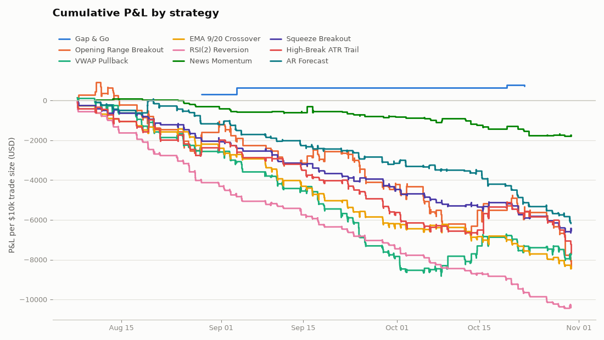

# Backtest results

Generated 2026-10-31 · window **2026-08-07 → 2026-10-30** ·
symbols **NVDA, TSLA, COIN, AMZN, JPM, XOM, UNH, WMT, CAT, LLY** · bars **5m** ·
**$10,000** per trade · slippage **5 bps/side** ·
**2298 long / 2323 short**, everything flat by 15:55 ET.

## Ranking (by win rate)

| strategy | trades | win_rate_pct | avg_win | avg_loss | profit_factor | expectancy | total_pnl | max_drawdown | median_hold_min |
|---|---|---|---|---|---|---|---|---|---|
| Gap & Go | 4 | 75.0 | 263.2 | -58.27 | 13.55 | 182.83 | 731.32 | -58.27 | 348.0 |
| AR Forecast | 653 | 40.3 | 29.1 | -35.49 | 0.55 | -9.47 | -6187.0 | -6267.43 | 25.0 |
| Opening Range Breakout | 499 | 39.9 | 98.32 | -92.6 | 0.7 | -16.46 | -8213.28 | -9322.54 | 340.0 |
| VWAP Pullback | 715 | 35.7 | 72.38 | -56.81 | 0.71 | -10.74 | -7677.16 | -8970.35 | 135.0 |
| RSI(2) Reversion | 1146 | 35.5 | 11.2 | -20.26 | 0.3 | -9.09 | -10414.16 | -10398.68 | 15.0 |
| High-Break ATR Trail | 437 | 33.2 | 65.76 | -58.85 | 0.55 | -17.51 | -7650.59 | -7582.67 | 150.0 |
| News Momentum | 85 | 29.4 | 53.14 | -51.89 | 0.43 | -21.0 | -1785.15 | -1889.66 | 80.0 |
| Squeeze Breakout | 435 | 26.2 | 46.41 | -36.89 | 0.45 | -15.06 | -6551.36 | -6595.51 | 50.0 |
| EMA 9/20 Crossover | 647 | 23.6 | 51.76 | -32.98 | 0.49 | -12.94 | -8373.18 | -8444.89 | 60.0 |

Win rate alone doesn't pay — a high-win-rate strategy with avg losses larger than
avg wins can still lose money. Read it together with **profit_factor** (gross
wins / gross losses, >1 is profitable) and **expectancy** (avg $ per trade).

## How each strategy's trades ended (% of trades)

| strategy | eod | signal | stop | target |
|---|---|---|---|---|
| AR Forecast | 0.0 | 94.6 | 5.4 | 0.0 |
| EMA 9/20 Crossover | 21.8 | 57.5 | 20.7 | 0.0 |
| Gap & Go | 100.0 | 0.0 | 0.0 | 0.0 |
| High-Break ATR Trail | 33.0 | 0.0 | 67.0 | 0.0 |
| News Momentum | 43.5 | 0.0 | 47.1 | 9.4 |
| Opening Range Breakout | 72.5 | 0.0 | 23.4 | 4.0 |
| RSI(2) Reversion | 0.8 | 95.3 | 3.9 | 0.0 |
| Squeeze Breakout | 28.5 | 0.0 | 60.0 | 11.5 |
| VWAP Pullback | 39.3 | 0.0 | 47.7 | 13.0 |

`stop` = protective stop hit · `target` = fixed take-profit hit ·
`signal` = strategy's own exit rule · `eod` = flattened at the session cutoff.

## Long vs short, per strategy

| strategy | long trades | long exp./trade | short trades | short exp./trade |
|---|---|---|---|---|
| Gap & Go | 2 | $+241.35 | 2 | $+124.31 |
| Opening Range Breakout | 255 | $-24.46 | 244 | $-8.09 |
| VWAP Pullback | 358 | $-16.15 | 357 | $-5.31 |
| EMA 9/20 Crossover | 334 | $-18.05 | 313 | $-7.49 |
| RSI(2) Reversion | 568 | $-9.69 | 578 | $-8.49 |
| News Momentum | 41 | $-26.64 | 44 | $-15.74 |
| Squeeze Breakout | 220 | $-17.05 | 215 | $-13.02 |
| High-Break ATR Trail | 224 | $-21.25 | 213 | $-13.57 |
| AR Forecast | 296 | $-9.54 | 357 | $-9.42 |

Each side read as its own book. The walk-forward version of this question — with
the live long-gate policy scored against random selection — is in REGIME.md.

Full trade-by-trade log: [trades.csv](trades.csv).

*Small sample (yfinance caps 5-minute history at 60 days), one market regime,
liquid large caps rather than true low-float gappers — see the README's
limitations section before reading anything into these numbers.*
