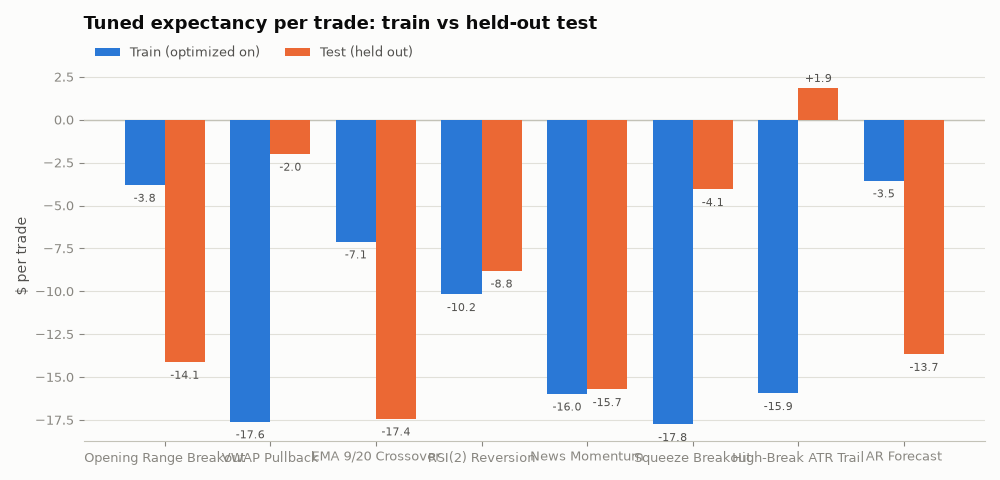

# Parameter tuning — train/test split

Generated 2026-10-17 · optimized on the first **36 sessions**
(before 2026-09-15), validated on the held-out **24 sessions** · objective:
**expectancy per trade** (never win rate — see v0.1) · parameter sets with fewer
than 20 train trades are discarded as noise.

| strategy | best params (train) | train exp./trade | test exp./trade | test exp. (defaults) | test trades | test win rate | test P&L |
|---|---|---|---|---|---|---|---|
| Gap & Go | n/a (too few trades) | — | — | $+181.03 | 2 | — | — |
| Opening Range Breakout | {'range_bars': 3, 'target_r': 3.0, 'stop_at_mid': False} | $-3.81 | $-14.13 | $-6.65 | 115 | 36.5% | $-1,625 |
| VWAP Pullback | {'target_r': 3.0, 'stop_buffer': 0.997} | $-17.60 | $-2.00 | $-10.15 | 174 | 32.8% | $-349 |
| EMA 9/20 Crossover | {'fast': 9, 'slow': 20, 'stop_bars': 5} | $-7.11 | $-17.43 | $-17.43 | 161 | 23.0% | $-2,806 |
| RSI(2) Reversion | {'entry_level': 10.0, 'exit_level': 50.0, 'stop_pct': 0.01} | $-10.18 | $-8.81 | $-8.36 | 260 | 43.1% | $-2,290 |
| News Momentum | {'window_min': 60, 'vol_mult': 1.2, 'target_r': 1.5} | $-15.98 | $-15.72 | $-22.55 | 59 | 30.5% | $-928 |
| Squeeze Breakout | {'bw_lookback': 12, 'target_r': 1.5} | $-17.76 | $-4.06 | $-7.33 | 113 | 39.8% | $-459 |
| High-Break ATR Trail | {'window_bars': 6, 'trail_atr_mult': 1.5} | $-15.95 | $+1.88 | $-2.83 | 124 | 35.5% | $+233 |
| AR Forecast | {'lags': 6, 'horizon': 12, 'threshold': 0.001} | $-3.55 | $-13.67 | $-7.83 | 277 | 45.1% | $-3,787 |

## How to read this

- **train → test shrinkage is the overfitting, made visible.** Parameters that
  look best in-sample routinely give most of it back out-of-sample; the gap
  between the two columns is the honest measure of how much the grid search
  just memorized.
- **"test exp. (defaults)"** is the untuned textbook strategy on the same
  held-out sessions — the bar tuning has to beat to claim any value.
- With ~24 test sessions this is still a small sample; treat survivors as
  candidates for paper trading, not conclusions.

## Live promotion (survivor gate)

A tuned set trades live as `<strategy>_tuned` only once it has been the grid's
winner with **identical parameters** and has **beaten the defaults on the held-out
split** in each of the last 3 weekly runs. Everything else keeps
trading on defaults only.

| strategy | live | why |
|---|---|---|
| Opening Range Breakout | held back | best parameters changed within the last 3 runs |
| VWAP Pullback | held back | best parameters changed within the last 3 runs |
| EMA 9/20 Crossover | held back | best parameters changed within the last 3 runs |
| RSI(2) Reversion | held back | best parameters changed within the last 3 runs |
| News Momentum | held back | best parameters changed within the last 3 runs |
| Squeeze Breakout | held back | did not beat the defaults on held-out data in all 3 runs |
| High-Break ATR Trail | held back | best parameters changed within the last 3 runs |
| AR Forecast | held back | best parameters changed within the last 3 runs |

Consecutive runs share most of their 60-day window, so passing shows the result
*persists*, not that it's independently confirmed — the live `_tuned` vs default
comparison in the paper journal is the real test.
