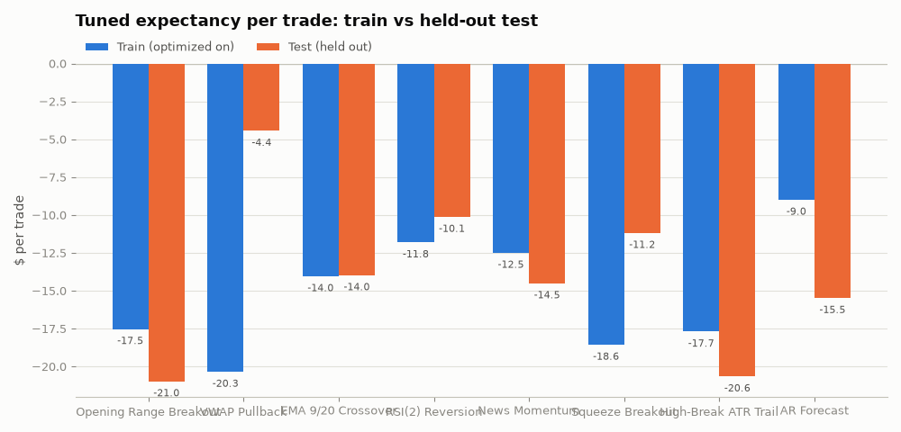

# Parameter tuning — train/test split

Generated 2026-11-07 · optimized on the first **36 sessions**
(before 2026-10-06), validated on the held-out **24 sessions** · objective:
**SPY-adjusted expectancy per trade** (P&L net of a beta-weighted SPY hedge — raw P&L rewards whatever direction the market drifted; never win rate) · parameter sets with fewer
than 20 train trades are discarded as noise.

| strategy | best params (train) | train exp./trade | test exp./trade | test exp. (defaults) | test trades | test win rate | test P&L |
|---|---|---|---|---|---|---|---|
| Gap & Go | n/a (too few trades) | — | — | $+42.15 | 2 | — | — |
| Opening Range Breakout | {'range_bars': 6, 'target_r': 1.5, 'stop_at_mid': False} | $-17.52 | $-20.97 | $-19.73 | 176 | 46.6% | $-2,153 |
| VWAP Pullback | {'target_r': 1.5, 'stop_buffer': 0.997} | $-20.34 | $-4.44 | $-3.18 | 281 | 44.1% | $+299 |
| EMA 9/20 Crossover | {'fast': 5, 'slow': 20, 'stop_bars': 5} | $-14.04 | $-13.97 | $-13.83 | 283 | 23.0% | $-3,681 |
| RSI(2) Reversion | {'entry_level': 5.0, 'exit_level': 70.0, 'stop_pct': 0.01} | $-11.80 | $-10.12 | $-10.92 | 192 | 51.0% | $-997 |
| News Momentum | {'window_min': 60, 'vol_mult': 1.2, 'target_r': 1.5} | $-12.49 | $-14.50 | $-19.52 | 99 | 34.3% | $-1,446 |
| Squeeze Breakout | {'bw_lookback': 12, 'target_r': 1.5} | $-18.56 | $-11.18 | $-11.06 | 179 | 36.3% | $-1,479 |
| High-Break ATR Trail | {'window_bars': 6, 'trail_atr_mult': 3.0} | $-17.69 | $-20.65 | $-19.27 | 202 | 44.6% | $-2,500 |
| AR Forecast | {'lags': 6, 'horizon': 6, 'threshold': 0.002} | $-8.99 | $-15.47 | $-15.71 | 166 | 36.1% | $-2,398 |

## How to read this

- **train → test shrinkage is the overfitting, made visible.** Parameters that
  look best in-sample routinely give most of it back out-of-sample; the gap
  between the two columns is the honest measure of how much the grid search
  just memorized.
- **"test exp. (defaults)"** is the untuned textbook strategy on the same
  held-out sessions — the bar tuning has to beat to claim any value.
- With ~24 test sessions this is still a small sample; treat survivors as
  candidates for paper trading, not conclusions.

## Live promotion (survivor gate)

A tuned set trades live as `<strategy>_tuned` only once it has been the grid's
winner with **identical parameters** and has **beaten the defaults on the held-out
split** in each of the last 3 weekly runs. Everything else keeps
trading on defaults only.

| strategy | live | why |
|---|---|---|
| Opening Range Breakout | held back | best parameters changed within the last 3 runs |
| VWAP Pullback | held back | best parameters changed within the last 3 runs |
| EMA 9/20 Crossover | held back | best parameters changed within the last 3 runs |
| RSI(2) Reversion | held back | best parameters changed within the last 3 runs |
| News Momentum | held back | did not beat the defaults on held-out data in all 3 runs |
| Squeeze Breakout | held back | did not beat the defaults on held-out data in all 3 runs |
| High-Break ATR Trail | held back | best parameters changed within the last 3 runs |
| AR Forecast | held back | best parameters changed within the last 3 runs |

Consecutive runs share most of their 60-day window, so passing shows the result
*persists*, not that it's independently confirmed — the live `_tuned` vs default
comparison in the paper journal is the real test.
